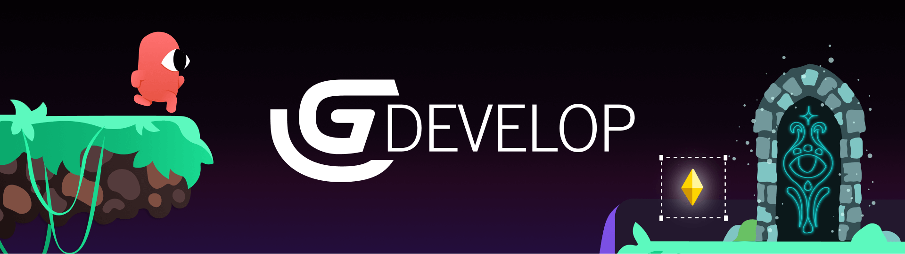
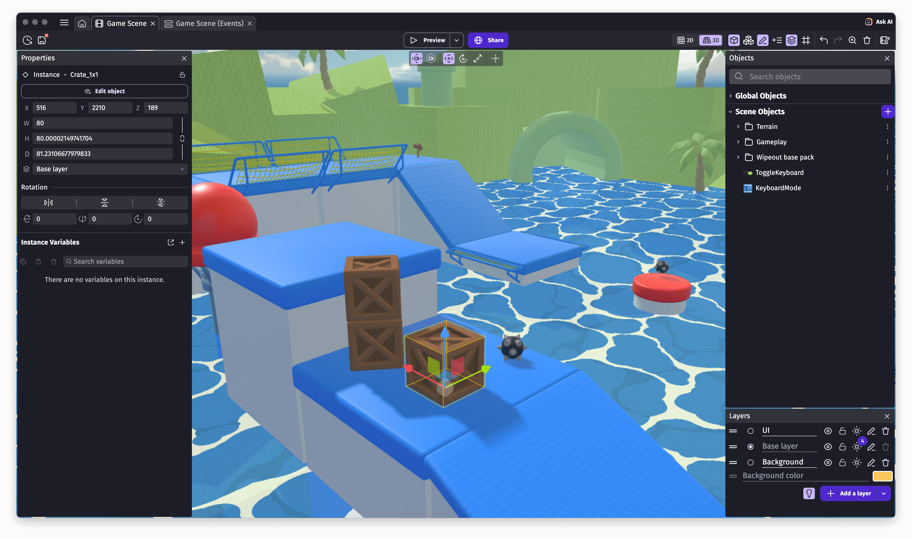
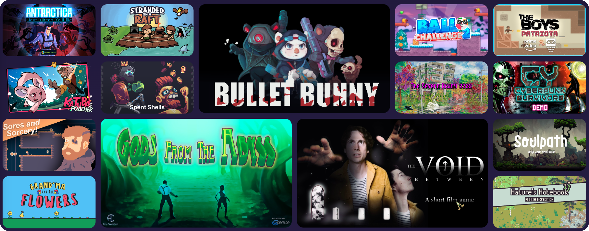

<!DOCTYPE html>
<html>
<head>
  <title>Crystal Cavern</title>
  
</head>
<body>
<canvas id="game" width="480" height="640"></canvas>

</body>
</html>

GDevelop is a **full-featured, no-code, open-source** game development software. You can build **2D, 3D and multiplayer games** for mobile (iOS, Android), desktop and the web. GDevelop is designed to be fast and incredibly intuitive: make games using an easy-to-understand yet powerful event-based system and modular behaviors. Create with AI that assists or builds alongside you.

## Getting started

| ❔ I want to...                                   | 🚀 What to do                                                                                                                                                     |
| ------------------------------------------------- | ----------------------------------------------------------------------------------------------------------------------------------------------------------------- |
| 🎮 Use GDevelop to make games                     | Go to [GDevelop homepage](https://gdevelop.io) to download the app!                                                                                               |
| ⚙️ Create/improve an extension                    | Read about [creating an extension](https://wiki.gdevelop.io/gdevelop5/extensions/create), with no-code or code.                                                   |
| 🧑‍💻 Contribute to the editor or game engine        | Follow this [README](newIDE/README.md).                                                                                                                           |
| 👾 Create or sell a game template                 | Submit a [free example or a paid template on the Asset Store](https://wiki.gdevelop.io/gdevelop5/community/guide-for-submitting-an-example/).                     |
| 🎨 Share or sell an asset pack                    | Submit a [free or paid asset pack on the Asset Store](https://wiki.gdevelop.io/gdevelop5/community/sell-asset-pack-store).                                        |
| 🌐 Help translate GDevelop                        | Go on the [GDevelop project on Crowdin](https://crowdin.com/project/gdevelop) or translate [in-app tutorials](https://github.com/GDevelopApp/GDevelop-tutorials). |
| 👥 Get online game services or commercial support | See offers for [professionals, teams or individual creators](https://gdevelop.io/pricing).                                                                        |

> Are you interested in contributing to GDevelop for the first time? Take a look at the list of **[good first issues](https://github.com/4ian/GDevelop/issues?q=is%3Aissue+is%3Aopen+label%3A%22%F0%9F%91%8Cgood+first+issue%22)**, **[good first contributions](https://github.com/4ian/GDevelop/discussions/categories/good-first-contribution)** or the **["🏐 not too hard" cards](https://trello.com/b/qf0lM7k8/gdevelop-roadmap?menu=filter&filter=label:Not%20too%20hard%20%E2%9A%BD%EF%B8%8F)** on the Roadmap.

## Games made with GDevelop

- Find GDevelop games on [gd.games](https://gd.games), the gaming platform for games powered by GDevelop.
- See the [showcase of games](https://gdevelop.io/games) created with GDevelop and published on Steam, iOS (App Store), Android (Google Play), Itch.io, Newgrounds, CrazyGames, Poki...

## Technical architecture

GDevelop is composed of an **editor**, a **game engine**, an **ecosystem** of extensions as well as **online services** and commercial support.

| Directory     | ℹ️ Description                                                                                                                                                                                                                                                                                           |
| ------------- | -------------------------------------------------------------------------------------------------------------------------------------------------------------------------------------------------------------------------------------------------------------------------------------------------------- |
| `Core`        | Core classes, describing the structure of a game and tools to implement the IDE and work with GDevelop games.                                                                                                                                                                                            |
| `GDJS`        | The game engine, written in TypeScript, using PixiJS and Three.js for 2D and 3D rendering (WebGL), powering all GDevelop games.                                                                                                                                                                          |
| `GDevelop.js` | Bindings of `Core`, `GDJS` and `Extensions` to JavaScript (with WebAssembly), used by the IDE.                                                                                                                                                                                                           |
| `newIDE`      | The game editor, written in JavaScript with React, Electron, PixiJS and Three.js.                                                                                                                                                                                                                        |
| `Extensions`  | Built-in extensions for the game engine, providing objects, behaviors and new features. For example, this includes the physics engines running in WebAssembly (Box2D or Jolt Physics for 3D). All the [official and experimental extensions are on this repository](https://github.com/GDevelopApp/GDevelop-extensions). [Community extensions are available here](https://github.com/GDevelopApp/GDevelop-community-list). |

To learn more about GDevelop Architecture, read the [architecture overview here](Core/GDevelop-Architecture-Overview.md).

Pre-generated documentation of the game engine is [available here](https://docs.gdevelop.io).

Status of the tests and builds:    

## Links

### Community

- [GDevelop forums](https://forum.gdevelop.io) and [Discord chat](https://discord.gg/gdevelop).
- [GDevelop homepage](https://gdevelop.io).
- [GDevelop wiki (documentation)](https://wiki.gdevelop.io/gdevelop5/start).
- Help translate GDevelop in your language: [GDevelop project on Crowdin](https://crowdin.com/project/gdevelop).
- Open-source [extensions (official or experimental)](https://github.com/GDevelopApp/GDevelop-extensions), [community extensions](https://github.com/GDevelopApp/GDevelop-community-list), [examples](https://github.com/GDevelopApp/GDevelop-examples), [tutorials](https://github.com/GDevelopApp/GDevelop-tutorials) are on GitHub.

### Development Roadmap

- [GDevelop Roadmap on Trello.com](https://trello.com/b/qf0lM7k8/gdevelop-roadmap), for a global view of the features that could be added. Please vote and comment here for new features/requests.
- [GitHub issue page](https://github.com/4ian/GDevelop/issues), for technical issues and bugs.
- [Github discussions](https://github.com/4ian/GDevelop/discussions) to talk about new features and ideas.

## License

- The Core library, the native and HTML5 game engines, the IDE, and all extensions (respectively `Core`, `GDJS`, `newIDE` and `Extensions` folders) are under the **MIT license**.
- The name, GDevelop, and its logo are the exclusive property of Florian Rival.

Games exported with GDevelop are based on the GDevelop game engine (see `Core` and `GDJS` folders): this engine is distributed under the MIT license so that you can **distribute, sell or do anything** with the games you created with GDevelop. In particular, you are not forced to make your game open-source.

[node.js]: https://nodejs.org

## Star History

Help us spread the word about GDevelop by starring the repository on GitHub!

